<p align="center"></p>

# Claudinho

A small macOS menu bar app that shows how much of your **Claude** and **Codex** usage limits you've burned, without opening a browser or typing `/usage`.

I kept getting cut off mid-task by the 5-hour limit with no idea I was close. Claudinho puts the numbers next to the clock, so you can see at a glance whether you have room for one more big refactor or should wait for the reset.

> UI is currently in Portuguese (pt-BR). English localization is welcome.

## What it shows

- **Every Claude limit on your plan**: the 5-hour session, the weekly limit across all models and the per-model weekly limits (e.g. Opus), each with a progress bar and a reset countdown
- **A pace marker** on each bar: where you'd be if you spread your usage evenly until the reset. Bar past the marker means you're going faster than the limit allows
- **Extra usage credits** spent this month, when enabled on your account
- **Codex limits** (session and weekly, plus your ChatGPT plan), if you use the Codex CLI
- **Menu bar text** you can pick: session + weekly, every limit, only the highest one, or just the icon. It turns red at 90%

It refreshes every minute and again when you open the popover. If the API rate-limits it, it backs off for as long as the server asks.

## Setup

There's nothing to configure. Claudinho reuses the logins you already have:

| Service | Where it reads the login from | What you need |
|---|---|---|
| Claude | macOS Keychain item `Claude Code-credentials` (falls back to `~/.claude/.credentials.json`) | Run `claude` once and log in with your Claude account |
| Codex | `~/.codex/auth.json` | Run `codex` once and log in with ChatGPT |

If Codex isn't logged in, its section is just hidden. When a token expires, using the CLI in any terminal refreshes it, and Claudinho picks up the new one on the next poll.

## Install

Requires macOS 14+, an Apple Silicon Mac and the Xcode command line tools (`xcode-select --install`).

```bash
git clone https://github.com/phmucelin/claudinho.git
cd claudinho
./build.sh install   # builds, copies to /Applications and launches
```

`./build.sh` alone just builds `build/Claudinho.app`. Turn on **Abrir ao iniciar o Mac** in the gear menu to start it at login.

## Privacy

- Your tokens are read locally and sent only to the provider that issued them (Anthropic for Claude, OpenAI for Codex), over HTTPS.
- No analytics, no third-party servers, no network calls other than the two below.
- The only thing Claudinho stores is your menu bar preferences, in `UserDefaults`.

## How it works

- Claude: `GET https://api.anthropic.com/api/oauth/usage` with the Claude Code OAuth token. The keychain is read through `/usr/bin/security`, the same tool Claude Code uses to write it, so there's no extra permission prompt.
- Codex: `GET https://chatgpt.com/backend-api/wham/usage`, the endpoint the Codex CLI uses for `/status`.
- Plain Swift + SwiftUI, no dependencies, no Xcode project. `build.sh` compiles with `swiftc`, draws the icon programmatically and ad-hoc signs the bundle.

```
Sources/
  main.swift        menu bar item and popover
  UsageStore.swift  polling, backoff, preferences
  UsageAPI.swift    Claude endpoint + credential lookup
  CodexAPI.swift    Codex endpoint
  UsageView.swift   popover UI
  Clawd.swift       pixel-art icon
tools/makeicon/     renders the app icon at build time
```

## Disclaimer

This is a personal project, not affiliated with or endorsed by Anthropic or OpenAI. Both usage endpoints are undocumented and can change or disappear without notice; if the popover shows "Resposta da API em formato inesperado", that's probably what happened. Please open an issue.

## License

[MIT](LICENSE)
